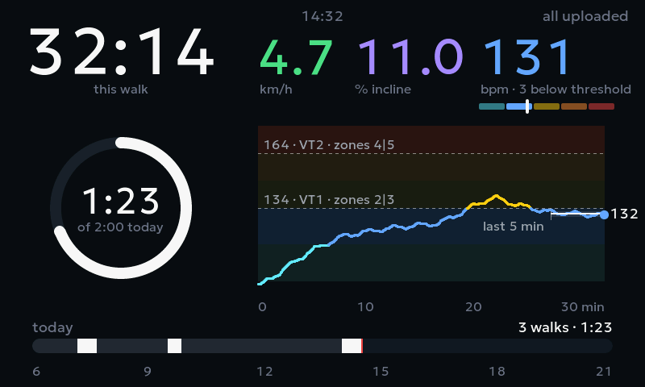
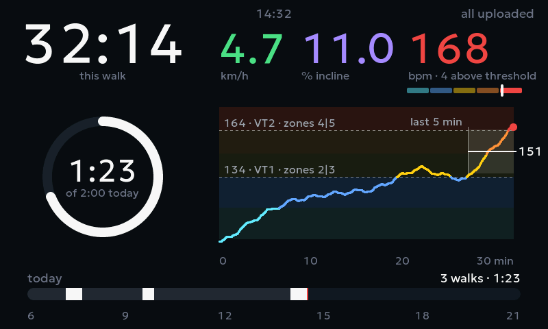
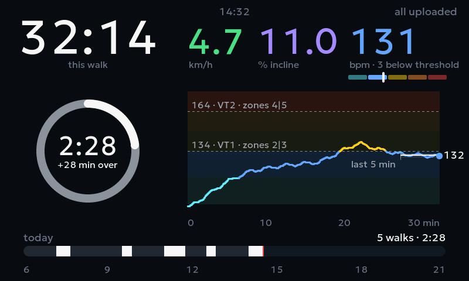
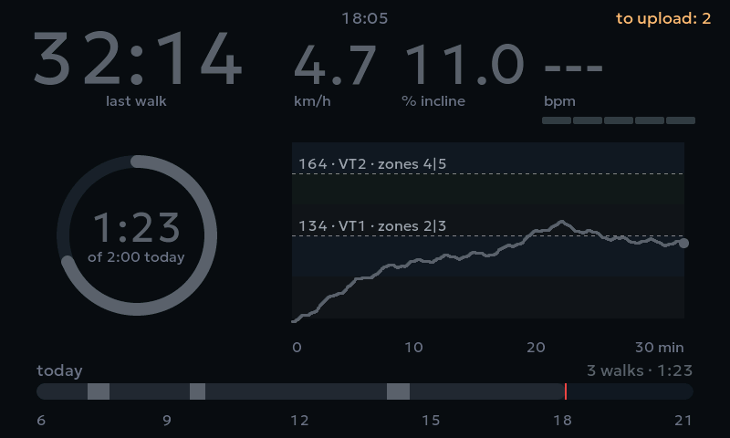
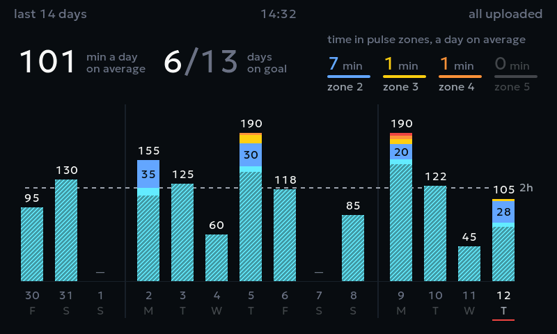
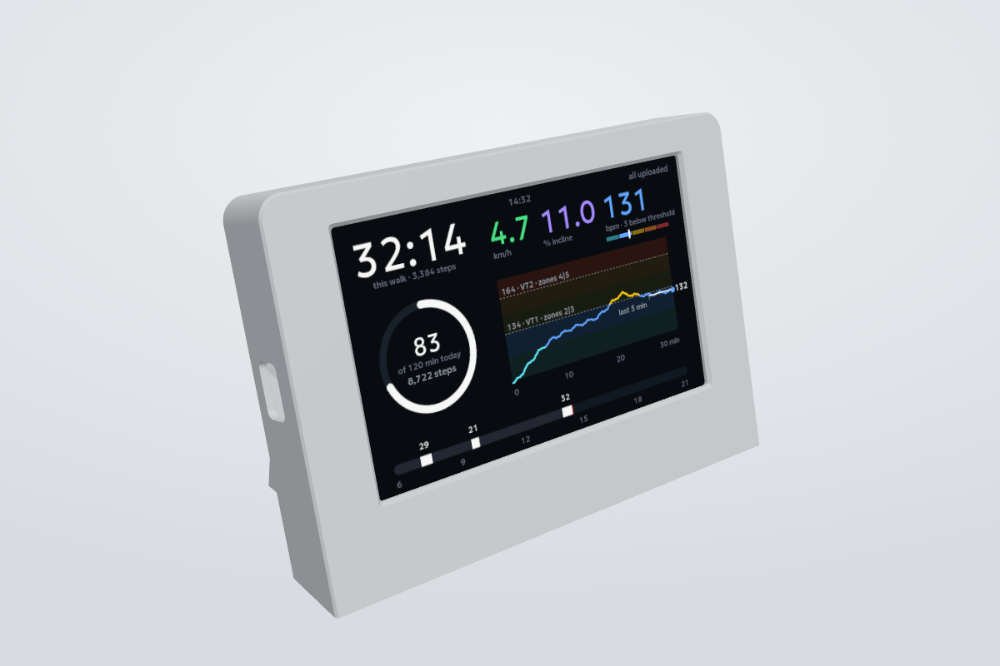

# TreadPulse

### Work while you walk? You need this.

Shows and records your treadmill walks and heart rate without a single tap: no squinting at the treadmill's own display, often tucked under the desk, and no phone app to open and connect to a heart rate strap. Step on and walk.

A big, glanceable second screen for your treadmill: walking time, a daily goal ring and live heart rate zones that beep when you cross your thresholds. Works with any treadmill that speaks the standard Bluetooth fitness machine protocol (FTMS).



## Features

- **This walk, in big digits.** Walking time runs only while the belt moves, with the steps under it ([estimated from the speed](docs/how-it-works.md#steps)). Speed and incline next to it.
- **Daily goal ring.** Minutes walked today out of your goal, and today's steps. Past the goal, a second, brighter lap. Tap the ring to count in hours and minutes ("1h 23m") instead.
- **Heart rate zones.** The pulse is colored by zone, with a five-zone scale and how far you are from the next threshold.
- **Pulse chart of the walk** with your two thresholds and where your pulse sat over the last 5 minutes.
- **Beeps** when the pulse crosses a threshold, and when the treadmill link drops mid-walk.
- **Day strip:** when you walked today, with each walk's minutes over it.
- **The last two weeks:** swipe sideways for a bar per day, split by pulse zone (striped where you walked without the strap), with weeks set apart, your average day in minutes and steps, the days on goal and in a row, and the average day's minutes in zones 2 to 5. The history stays on the board, so this works without the cloud; the dashboard comes back when the belt starts.
- **Every walk logged:** per-second data, segments at constant speed and incline, a summary. Uploaded to your own cloud storage as CSV; one line per walk also stays on the board for good. A walk under a minute (an accidental start) leaves no trace.
- **No stale numbers:** grey means no fresh data from the treadmill or the strap.

| Above the interval threshold | Daily goal met, in hours and minutes | After the walk |
|---|---|---|
|  |  |  |

**Swipe sideways for the last two weeks.** One bar per day: the striped part is walking without the strap, the colors above it are the pulse zones, with each zone's minutes inside when they fit. On top, over the full days (today joins tomorrow): your average day in minutes and steps, how many days reached the goal and how many in a row up to now, and how many minutes of the average day fall into zones 2 to 5.



<sub>Screens rendered by the built-in simulator with the example settings and made-up walks.</sub>

## Hardware

| Part | What to get |
|---|---|
| Display board | [Freenove ESP32-S3 Display 5″](https://store.freenove.com/products/fnk0115) (FNK0115, [docs](https://docs.freenove.com/projects/fnk0115/en/latest/)): 800×480 screen, ESP32-S3, speaker. |
| Treadmill | Any with Bluetooth [FTMS](https://www.bluetooth.com/specifications/specs/fitness-machine-service-1-0/). Look for it in the specs; treadmills that work with apps like Zwift or Kinomap usually have it. Tested on the [Merach W50](https://merachfit.eu/products/merach-w50-treadmill). |
| Heart rate strap (optional) | Any Bluetooth chest strap, e.g. [Polar H10](https://www.polar.com/en/sensors/h10-heart-rate-sensor). |
| Power | Any USB-C phone charger. |
| Desk stand (optional) | Print it: two parts, about 95 g of PLA, plus four 3 × 14 mm screws. [See it in 3D](https://dmial.github.io/treadpulse/enclosure/viewer.html); files, print settings and assembly in [enclosure](enclosure/). |



<sub>The desk stand, rendered from its [3D model](https://dmial.github.io/treadpulse/enclosure/viewer.html).</sub>

## How it works

- **Bluetooth in.** The board connects to the first treadmill and the first heart rate strap it finds. Nothing to pair.
- **No SD card.** Walks are written to the board's own memory: about 40 hours of walking fit.
- **Wi-Fi only between walks**, because it shares the radio with Bluetooth: at power-on and after each walk, to set the clock and upload walks.
- **Your own cloud, optional.** A tiny Cloudflare Worker stores walk files in your R2 bucket. The free tier is plenty: a year of hour-long daily walks is about 90 MB.

| Without | You lose |
|---|---|
| Heart rate strap | Pulse, zones, chart and beeps. Time, speed and incline still work. |
| Wi-Fi | The clock. The daily ring counts only walks since power-on, and the day strip stays empty. |
| Cloud receiver | Your walk logs. They stay on the board, where the oldest is dropped when memory runs out. |

## Build your own

1. Install [PlatformIO](https://platformio.org/install/ide?install=vscode): the VS Code extension, or `brew install platformio` for the command line.
2. Get the code:

   ```bash
   git clone https://github.com/dmial/treadpulse.git && cd treadpulse
   ```

3. Make your two personal files from the templates. Git ignores them, so your data stays on your computer.

   ```bash
   cp src/secrets.example.h src/secrets.h
   cp src/user_config.example.h src/user_config.h
   ```

   - `src/secrets.h`: Wi-Fi name and password (2.4 GHz networks only), plus the cloud receiver's address and key (leave them empty for now).
   - `src/user_config.h`: your heart rate zones and two thresholds, daily goal, time zone, step formula.

4. Connect the board by USB-C and flash it:

   ```bash
   pio run -e freenove_s3_5in -t upload
   ```

   The first build takes several minutes: PlatformIO downloads ESP-IDF and recompiles the Arduino core, which keeps the screen from flickering while walks are written. If the computer doesn't see the board, install the [CH340 driver](https://github.com/Freenove/Freenove_ESP32_S3_Display_FNK0115/tree/main/CH340).

5. Close the treadmill's phone app (a treadmill takes one Bluetooth connection at a time), put on the strap and start walking.

To change a setting, edit the file and flash again. Flashing keeps the walks that are not uploaded yet.

### Cloud receiver (optional)

Needs [Node.js](https://nodejs.org/) and a free Cloudflare account. In the `cloud` folder:

```bash
cd cloud && npm install
```

```bash
npx wrangler login
```

```bash
npx wrangler r2 bucket create treadmill-walks
```

```bash
npx wrangler deploy
```

`deploy` prints the receiver's address, like `https://treadmill-upload.<you>.workers.dev`. Make up a key (`openssl rand -hex 32`) and give it to the receiver; it asks for the value:

```bash
npx wrangler secret put UPLOAD_TOKEN
```

Put the address and the same key into `src/secrets.h` (`kUploadUrl`, `kUploadToken`) and flash again. Walks show up in the Cloudflare dashboard under R2 → `treadmill-walks`. The receiver can only write, so the key inside the firmware can't read your data back.

### Without a board

```bash
pio run -e sim && mkdir -p screens && .pio/build/sim/program screens
```

renders the screens above into BMP files in `screens/` (needs `src/user_config.h`). `pio test -e native` runs the tests.

## Troubleshooting

- **Time, speed and incline are grey.** The board doesn't see the treadmill. Close the treadmill's app on your phone.
- **Dashes instead of the pulse.** The strap only wakes up when worn: wet the electrodes and put it on.
- **`to upload` doesn't go down.** In red it says why: `no Wi-Fi` or `upload failed`, and when the board tries again. Check the Wi-Fi (2.4 GHz) and the receiver's address and key in `src/secrets.h`. The board keeps its own log and sends it to the bucket as `logs/board.txt` whenever it gets online; look for `[wifi]` and `[upload]` lines. Live, over USB: `pio device monitor -e freenove_s3_5in`. Opening it restarts the board, so don't do it mid-walk.
- **No clock.** The board hasn't reached the internet since power-on.

More on walk files, uploads, power loss and the code: [how it works inside](docs/how-it-works.md).

## License

[MIT](LICENSE). The Geologica font in `lib/screen/fonts/` is under the [SIL Open Font License 1.1](lib/screen/fonts/OFL.txt).
